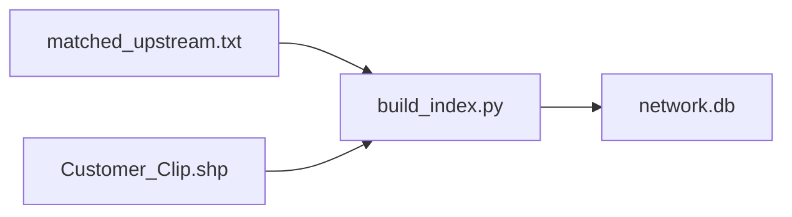
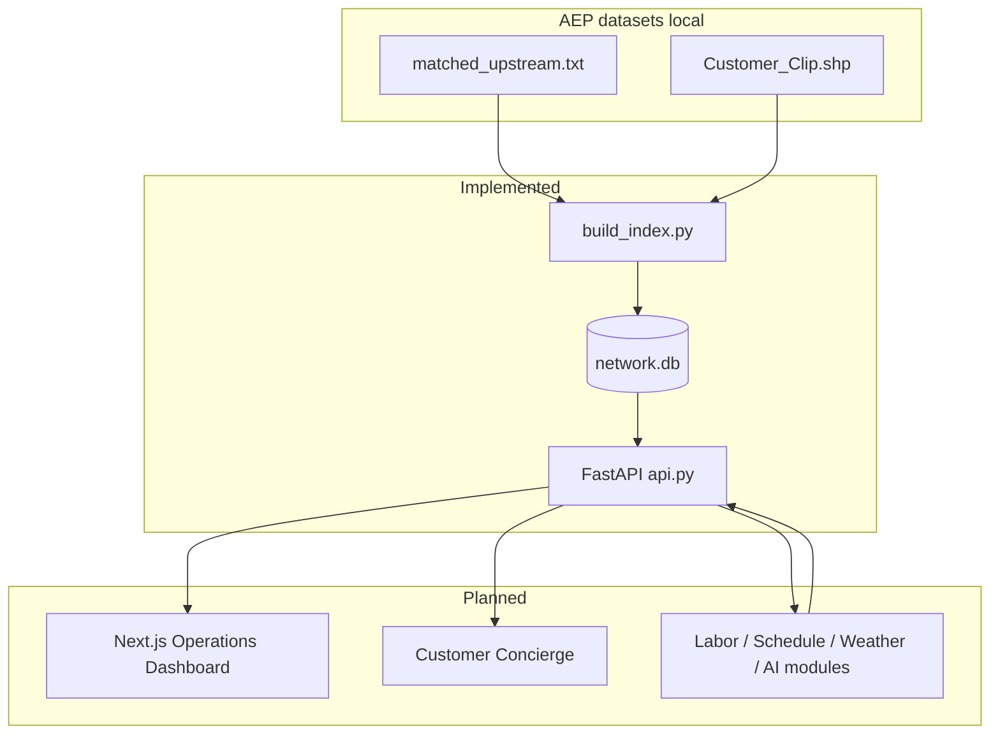

# GridAware — System Architecture

GridAware is an **AI Outage Concierge** for the **HackOHI/O 2026 American Electric Power (AEP)** challenge. It connects utility operations tooling with a customer-facing experience over a shared backend, using AEP-provided topology, customer GIS, and (when integrated) damage and weather datasets.

Authoritative judging criteria and dataset definitions live in the official **AEP Challenge Doc** and materials distributed at HackOHI/O 2026. This document describes how GridAware is designed to meet those themes and what is **implemented today** versus **planned**.

---

## Project overview

GridAware helps operators and customers reason about **potential** outage impact, restoration effort, and communication—without conflating dependency topology with confirmed outages.

| Interface | Primary users | Purpose |
|-----------|---------------|---------|
| **AEP Operations Dashboard** | Planners, dispatch, restoration engineers | Visualize dependency impact, explore equipment, and (planned) allocate crews and optimize step restoration |
| **Customer Concierge** | Residential and commercial customers | Outage **risk bands**, preparation guidance, restoration **estimates**, and alert eligibility (planned) |

Both interfaces call the same **Python / FastAPI** services backed by **SQLite** (`network.db`) and future modules for labor, scheduling, weather, and AI explanations.

---

## AEP challenge alignment (five requirement themes)

Map deliverables to the official challenge document for exact wording. GridAware is structured around these five themes:

1. **Network impact and operations visibility** — Which premises are **potentially** dependent on a device or event location; support for restoration planning views (dashboard + map).
2. **Damage intelligence** — Match **ARCOS** (or similar) damage records to network equipment **probabilistically**, with explicit match quality—not as ground-truth outage labels.
3. **Repair labor and duration** — Estimate repair effort using **AEP-provided labor references**, crew sizes **2–8**, and the **4.5 indirect labor multiplier** where the guide applies; express outputs as **ranges**, not false precision.
4. **Restoration scheduling and optimization** — Dependency-aware sequencing: upstream dependencies, customer counts, critical facilities, and **step restoration** (planned).
5. **Customer-facing risk, ETR, and alerts** — Weather- and infrastructure-informed **risk bands**, personalized restoration estimates tied to the **operations plan**, preparation tips, and alert eligibility—with responsible-AI guardrails.

---

## Current vs planned stack

### Implemented (backend)

| Layer | Technology | Location |
|-------|------------|----------|
| Preprocessing | Python, `pyshp`, SQLite | [`gridaware_network_starter/build_index.py`](gridaware_network_starter/build_index.py) |
| API | FastAPI, `uvicorn` | [`gridaware_network_starter/api.py`](gridaware_network_starter/api.py) |
| Storage | SQLite `network.db` (local, not for public repos) | [`gridaware_network_starter/`](gridaware_network_starter/) |

### Implemented (frontend — operations dashboard)

| Layer | Technology | Location |
|-------|------------|----------|
| Operations UI | Next.js (App Router), TypeScript, Tailwind CSS | [`frontend/`](frontend/) |
| Map | MapLibre GL JS (customer clusters + toggleable GIS layers) | `frontend/components/map/` |
| Dev integration | Next.js rewrite/proxy to FastAPI (`127.0.0.1:8000`) | `frontend/next.config.ts` |

### Implemented (GIS preprocessing — M2)

| Layer | Technology | Location |
|-------|------------|----------|
| Shapefile → WGS84 features | Python, `pyshp` | [`scripts/build_gis_layers.py`](scripts/build_gis_layers.py) |
| GIS store | SQLite `data/processed/gis.db` | derived; gitignored |
| GIS API | FastAPI `/gis/*` | [`gridaware_network_starter/gis_api.py`](gridaware_network_starter/gis_api.py) |

### Implemented (frontend — customer service context, Stage 3)

| Layer | Technology | Location |
|-------|------------|----------|
| Customer UI | Next.js route `/customer`, plain-English summaries | [`frontend/app/customer/`](frontend/app/customer/), [`CustomerDashboard.tsx`](frontend/components/customer/CustomerDashboard.tsx) |
| API client | `getCustomerNetworkContext` via same `/api/backend` proxy | [`frontend/lib/api.ts`](frontend/lib/api.ts) |
| Copy helpers | Service/network summaries, incomplete-data messaging | [`frontend/lib/customerContextSummary.ts`](frontend/lib/customerContextSummary.ts) |

**Outage Prediction** at `/prediction` (alias `/customer`) loads network context and storm risk APIs. **Restoration Simulator** at `/restoration` calls `/restoration/simulate`. **Operations GIS** remains at `/operations` (not in main nav). Home `/` redirects to `/prediction`.

Shared header: [`SiteHeader.tsx`](frontend/components/layout/SiteHeader.tsx) — Outage Prediction | Restoration Simulator.

---

## Data sources and preprocessing

### Inputs (competition data — local only)

Per [`gridaware_network_starter/README.md`](gridaware_network_starter/README.md):

- `matched_upstream.txt` — tab-separated rows: `premise_id`, then upstream tokens.
- `Customer_Clip` shapefile — premise locations and attributes.

Place files under `gridaware_network_starter/data/`. Do **not** commit raw AEP data or `network.db` to public GitHub.

### Upstream token format

Each token is four fields separated by `*`:

`source_type*source_id*device_type*location_id`

The API and database use **`device_key` = `source_type*source_id`**.

Example (verified via API): `eo_isolating_eqpt_inst*321305938` — device type `Recloser (Electronic)`, location `37800281C36078`, **2,811** potentially dependent premises.

### Build pipeline (`build_index.py`)

1. **Premises** — From shapefile fields `premise_nu`, `circuit_id`, and first shape point as `(longitude, latitude)`.
2. **Dependencies** — For each upstream line, for each valid 4-part token, insert `(device_key, premise_id)`. Per-line deduplication of `device_key` avoids duplicate inserts on the same row; table primary key is `(device_key, premise_id)`.
3. **Devices** — Distinct `device_key` rows with `device_type`, `location_id`, `source_type`, `source_id`.

**Not modeled in v1 index:** hop order along feeders, switching state, phase, dynamic reconfiguration, or a full electrical connectivity simulator.

---

## Database schema (verified)

Defined in `build_index.py` `CREATE TABLE` statements:

### `premises`

| Column | Type | Notes |
|--------|------|--------|
| `premise_id` | TEXT PK | From `premise_nu` |
| `longitude` | REAL | WGS84 |
| `latitude` | REAL | WGS84 |
| `circuit_id` | TEXT | From shapefile |

### `devices`

| Column | Type | Notes |
|--------|------|--------|
| `device_key` | TEXT PK | `source_type*source_id` |
| `device_type` | TEXT | From upstream token |
| `location_id` | TEXT | From upstream token; future GIS join (e.g. shapefile `location_n`) |
| `source_type` | TEXT | Token field |
| `source_id` | TEXT | Token field |

### `dependencies`

| Column | Type | Notes |
|--------|------|--------|
| `device_key` | TEXT | FK logical to `devices` |
| `premise_id` | TEXT | FK logical to `premises` |
| PRIMARY KEY | `(device_key, premise_id)` | Upstream **membership**, not ordered path |

### Indexes

- `idx_dependency_premise` on `dependencies(premise_id)`
- `idx_dependency_device` on `dependencies(device_key)` (created after bulk load)
- `idx_device_location` on `devices(location_id)`

Environment: `NETWORK_DB` overrides default path `network.db` ([`api.py`](gridaware_network_starter/api.py)).

---

## API surface (verified)

Base URL (local): `http://127.0.0.1:8000` — OpenAPI at `/docs`.

| Method | Path | Query / path params | Response (summary) |
|--------|------|---------------------|-------------------|
| GET | `/health` | — | `{ status, premises }` — premise count from DB |
| GET | `/devices/search` | `q` (min length 2), `limit` (default 20, max 100) | `{ devices: [{ device_key, device_type, location_id, dependent_premises }] }` — `LIKE` on `device_key` or `location_id` |
| GET | `/devices/impact` | `device_key`, `limit` (default 1000; customer rows capped at **5000**) | `{ device, potentially_dependent_premises, returned_customer_points, customers[], note }` — count is full dependency set; `customers` is limited for map performance |
| GET | `/premises/{premise_id}/upstream` | `premise_id` | `{ premise, upstream: [device rows] }` — 404 if premise missing |
| GET | `/customers/{premise_id}/network-context` | `premise_id` | Evidence-typed customer context (see **Customer network context** below) — 404 if premise missing |
| POST | `/customers/{premise_id}/risk-assessment` | JSON: `max_wind_gust_mph`, `total_precipitation_in`, `min_temperature_f`, `snowfall_in` | Historical weather–informed **relative** LOW/MEDIUM/HIGH concern; uses [`historical_weather_risk.py`](gridaware_network_starter/historical_weather_risk.py) + [`config/risk_model/historical_weather_risk_model.json`](config/risk_model/historical_weather_risk_model.json) — not outage probability |
| GET | `/restoration/network` | — | Illustrative network + labor reference metadata |
| GET | `/restoration/labor-config` | — | Versioned repair labor JSON |
| POST | `/restoration/simulate` | damaged components, workers, optional baseline order | Baseline vs optimized schedules — [`restoration_optimizer.py`](gridaware_network_starter/restoration_optimizer.py), [`docs/RESTORATION_MODEL.md`](docs/RESTORATION_MODEL.md) |

### Customer network context (evidence model)

Implementation: [`network_context_service.py`](gridaware_network_starter/network_context_service.py), [`network_context_api.py`](gridaware_network_starter/network_context_api.py), optional [`customer_clip.py`](gridaware_network_starter/customer_clip.py) for `Customer_Clip.shp` fields.

Each relationship in the response is labeled with an **evidence type**:

| Evidence type | Meaning |
|---------------|---------|
| `recorded_location_reference` | Customer shapefile field (e.g. `aep_xfmr_l`) → GIS `location_n` |
| `upstream_index_membership` | Row in `dependencies` from AEP upstream index — **unordered set**, not a path |
| `location_id_join` | `devices.location_id` equals GIS `location_n` (exact string) |
| `gis_attribute_reference` | GIS fields such as `upstream_l` or `location_1` — **not** verified conductors |

The API **does not** reconcile conflicting `circuit_id` values (e.g. equipment `0000005` vs line `0000006` at the same `location_n`). It reports them under `circuit_identifier_observations`. `normal_sta` is documented as a GIS as-built attribute, not live switching state.

Validated example: [`docs/VALIDATED_DEPENDENCY_CHAIN.md`](docs/VALIDATED_DEPENDENCY_CHAIN.md) (premise `000052580`).

**Scenario endpoints (M3A — simulated exposure, not outages):**

| Method | Path | Query | Response (summary) |
|--------|------|-------|-------------------|
| GET | `/scenarios/device-unavailable/summary` | `device_key` | Full `modeled_potential_exposure_count`, all `premise_ids`, device metadata, disclaimer — **no** `customers` geometry |
| GET | `/scenarios/device-unavailable` | `device_key` | Same counts plus **all** `customers[]` rows (no 5,000 cap) for map highlighting |

Implementation: [`scenario_service.py`](gridaware_network_starter/scenario_service.py), [`scenario_api.py`](gridaware_network_starter/scenario_api.py). `scenario_type` is `device_unavailable` today; response shape is intended to extend to multi-device union scenarios later.

**Impact response semantics:**

- `potentially_dependent_premises` — total rows in `dependencies` for the device.
- `returned_customer_points` — length of `customers` after `LIMIT`.
- `customers[]` — `{ premise_id, longitude, latitude, circuit_id }`.
- `note` — fixed disclaimer: dependency paths only; not verified outage or safe switching analysis.

**GIS endpoints (M2):**

| Method | Path | Notes |
|--------|------|--------|
| GET | `/gis/catalog` | Layer metadata, default visibility, join report |
| GET | `/gis/join-stats` | Exact `location_n` ↔ `devices.location_id` counts |
| GET | `/gis/features` | `layer`, optional `bbox=minLng,minLat,maxLng,maxLat`, `zoom`, `limit` (max 8000). Large layers require bbox. |
| GET | `/gis/location/{location_id}` | GIS assets + network devices with that exact identifier |
| GET | `/gis/study-area` | Default demo feeder metadata (`config/study_area.json` or regenerated `data/processed/study_area.json`) |
| GET | `/gis/features` | Optional `circuit=` filters infrastructure by GIS `circuit_id` / `aep_circui`; damage uses study geographic bbox when `circuit` is set |

**CORS:** not configured in current `api.py`. Browser clients should use a **same-origin proxy** (e.g. Next.js rewrites) during development.

Default dashboard study circuit **`0000005`** (Roanoke): documented in [`docs/STUDY_AREA.md`](docs/STUDY_AREA.md). Dependency/scenario APIs are **not** geographically filtered.

---

## AEP GIS inventory (verified from Data1.zip / Data2.zip)

Raw archives live in `data/raw/`. Emergency-facility shapefiles use **EPSG:3857** (Web Mercator) and are converted to WGS84 in the pipeline. All AEP network layers below are already **EPSG:4326**.

| Layer | Source shapefile | Records | Geometry | Identifier |
|-------|------------------|--------:|----------|------------|
| Primary lines | `Primary_ExportFeatures.shp` | 62,788 | Polyline | `location_n`, `location_1` |
| Secondary lines | `Secondary_ExportFeatures.shp` | 127,403 | Polyline | `location_n`, `location_1` |
| Poles | `Pole_Clip.shp` | 107,013 | PointZ | `location_n` |
| Transformers | `Transformer_Clip.shp` | 26,959 | PointZ | `location_n` |
| Fuses | `Fuse_Bank_Clip.shp` | 7,616 | PointZ | `location_n` |
| Reclosers | `Recloser_Bank_Clip.shp` | 331 | PointZ | `location_n` |
| Switches | `Switch_Clip.shp` | 900 | PointZ | `location_n` |
| Historical ARCOS damage | `arcos_prod_damage_09_28_Clip.shp` | 1,659 | PointZ | no `location_n`; has `Inform_Wor`, dates, `Circuit`, lat/lng |
| Ambulance | `Ambulance_Servi_Pairwis_Clip.shp` | 10 | PointZ / 3857 | USGS name/address |
| Fire stations | `Fire_Stations_E_Pairwis_Clip.shp` | 37 | PointZ / 3857 | USGS name/address |
| Hospitals | `Hospitals_Medic_Pairwis_Clip.shp` | 5 | PointZ / 3857 | USGS name/address |
| Customers | `Customer_Clip.shp` | 117,642 | PointZ | already indexed in `network.db` |

Shapefile field names are DBF-truncated (10 characters). The UI shows those actual names plus a short label map. No undocumented fields are invented.

### Topology join (verified)

Exact string match: GIS `location_n` = `devices.location_id`.

| Metric | Count |
|--------|------:|
| Devices in `network.db` | 32,600 |
| Distinct device `location_id` | 32,032 |
| Distinct matched location IDs | 31,912 |
| GIS features with a matched `location_n` | 146,968 |

Per-layer feature matches (exact ID only): reclosers 324/331, fuses 7,386/7,616, transformers 25,363/26,959, poles 25,596/107,013, primary 30,145/62,788, secondary 58,011/127,403, switches 143/900. Damage and emergency facilities have **no** `location_n` and are **not** joined.

The demo recloser `eo_isolating_eqpt_inst*321305938` (`location_id` `37800281C36078`) matches GIS recloser `321305929`, pole `309904926`, and line segments that share that location identifier.

**A match is an identifier join only.** It does not prove connectivity order, switching state, or a confirmed outage. ARCOS records are historical damage work, not outage labels.

---

## End-to-end data flow

**Operations dashboard (planned):** search devices → fetch impact → render customer GeoJSON on MapLibre; show counts labeled **Potentially Dependent Premises**, never as confirmed outages.

**Customer concierge (planned):** premise or account context → upstream devices + risk modules → ETR band and messaging; alerts gated on eligibility rules.

---

## Planned backend modules

Not implemented unless noted above.

| Module | Role | Data / rules |
|--------|------|----------------|
| **Network impact** | Device ↔ premise queries | **Implemented** via SQLite + current endpoints |
| **Damage matching** | ARCOS points on the map | **Displayed** as historical records. No `location_n` join; not outage labels. Probabilistic equipment match is still future work. |
| **Repair labor** | Hours / crew estimates | AEP labor tables; crews **2–8**; **4.5×** indirect multiplier when applicable |
| **Restoration scheduling** | Order repairs and step restoration | Upstream deps, impact counts, critical facilities |
| **Outage risk** | Weather + infrastructure signals | **Bands** only unless validated; not calibrated probabilities in UI |
| **Customer personalization** | Premise-level summaries | `/premises/{id}/upstream` + concierge context |
| **Alert eligibility** | Who gets proactive messages | Policy + consent; no alert without rules |
| **AI explanations** | Natural language over **structured** outputs | Must cite calculation inputs; must not invent crews, times, or outages |

---

## Operations plan → customer restoration estimate

Planned coupling (not yet built):

1. Operators define or adjust a **restoration plan** (ordered work, step restoration, crew assignments).
2. Scheduling module computes **ETR ranges** per premise or segment from labor estimates, dependencies, and plan order.
3. Customer concierge reads the **published plan version** (or scenario id) and shows the same structured ETR—not a separate hidden model.
4. When the plan changes, bump plan version; concierge refreshes estimates and optional notifications for eligible users.

Until scheduling exists, customer ETR must be labeled **illustrative** or omitted.

---

## Verified data vs assumptions vs simulation vs future

| Category | Examples | UI / API treatment |
|----------|----------|-------------------|
| **Verified from AEP index** | Premise coordinates, `device_key`, dependency counts, device metadata from tokens | Show as database facts; use precise labels for counts |
| **Model assumptions** | Labor hours per damage type, match scores, risk band thresholds | Document sources (AEP guide); show ranges |
| **Simulated / demo** | Hypothetical damage injects, weather scenarios for demos | Clearly marked “simulation” |
| **Future** | Full GIS layers, ARCOS ingestion, optimizer, LLM concierge | Not shown in production UI until implemented |

**Modeling rules (mandatory copy):**

- Equipment **dependencies do not prove** a confirmed outage.
- **ARCOS damage records are not** verified customer outage labels.
- **Weather risk bands** are not calibrated probabilities without validation studies.
- **AI** explains structured calculations; it does not invent operational results, crew assignments, or confirmed outage lists.

---

## Privacy and safety

- `network.db` maps anonymized/sanitized premises to locations—treat as **sensitive**; keep local; follow competition data-use rules.
- Do not expose the database via a public API or repository.
- Customer-facing features need least-privilege data (aggregates, bands, ETR ranges) and clear consent for alerts.
- Switching and isolation decisions require utility-grade tools—not this hackathon prototype.
- Any LLM output must be grounded in API JSON and labeled when uncertain.

---

## Extension points

- **GIS join:** `devices.location_id` ↔ shapefile `location_n` (truncated) for poles, reclosers, lines on the map.
- **New FastAPI routers** per module (`/labor`, `/schedule`, `/risk`) keeping SQLite or migrated store behind repositories.
- **Shared TypeScript types** in `frontend/lib/types.ts` mirroring API contracts for dashboard and concierge.

---

## Related docs

- Setup and rebuild: [`gridaware_network_starter/README.md`](gridaware_network_starter/README.md)
- Implementation progress: [`ROADMAP.md`](ROADMAP.md)
