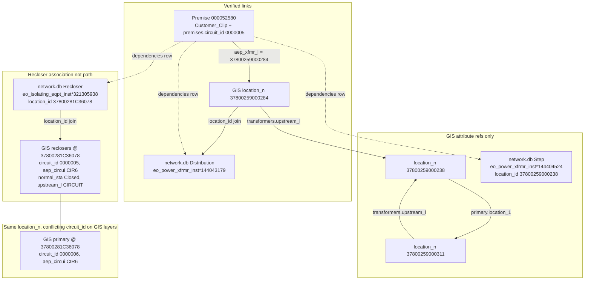

# Validated dependency chain investigation

Read-only analysis of **one example premise** using `network.db`, `data/processed/gis.db` (AEP shapefile attributes), and `Customer_Clip` fields. No application code was changed.

**Scripts used:** `scripts/validate_dependency_chain.py`, `scripts/validate_chain_detail.py`

---

## Example premise

| Source | Field | Value |
|--------|--------|--------|
| `network.db` → `premises` | `premise_id` | `000052580` |
| | `circuit_id` | `0000005` |
| | coordinates | −79.7366, 37.2886 |
| `Customer_Clip.shp` | `premise_nu` | `000052580` |
| | `circuit_id` | `0000005` |
| | `aep_xfmr_l` | `37800259000284` |
| | `aep_locati` | `37800259000284` |
| | `kind_of_se` | Underground |

This premise appears in the demo recloser dependency set (`eo_isolating_eqpt_inst*321305938`, 2,811 premises).

---

## What is verified vs what is not

| Relationship | Verified? | Evidence |
|--------------|-----------|----------|
| Premise ↔ customer service transformer location | **Yes (GIS customer field)** | `aep_xfmr_l` / `aep_locati` = `37800259000284` |
| Transformer location ↔ `network.db` distribution device | **Yes (ID join)** | `devices.location_id` = `37800259000284` → `eo_power_xfrmr_inst*144043179`, type `Distribution` |
| Premise ↔ devices in upstream index | **Yes (membership)** | Rows in `dependencies` for this `premise_id` |
| Device order upstream → downstream | **No** | Upstream file lists a **set** per premise; no directed edges in `network.db` |
| Premise ↔ recloser electrical path | **No** | Only co-membership in `dependencies` with recloser `37800281C36078` |
| GIS `upstream_l` / `location_1` as proof of conductors | **No** | Attribute references between location IDs or labels; not validated topology |
| `normal_sta` = operating / switching state for study | **No** | GIS attribute on recloser feature only; not tied to outage or simulation |

---

## Upstream index membership (`network.db`)

For premise **`000052580`**, `dependencies` + `devices` list (alphabetical by type, **not electrical order**):

| `device_key` | `device_type` | `location_id` |
|--------------|---------------|----------------|
| `eo_circuit*157965220` | Circuit Breaker | `0000005` |
| `eo_power_xfrmr_inst*144043179` | Distribution | `37800259000284` |
| `eo_isolating_eqpt_inst*140852957` | Recloser (Electronic) | `37800257D00037` |
| `eo_isolating_eqpt_inst*321305938` | Recloser (Electronic) | `37800281C36078` |
| `eo_isolating_eqpt_inst*140721757` | Recloser (Hydraulic) | `37800234D00029` |
| `eo_power_xfrmr_inst*144404524` | Step | `37800259000238` |

The index answers: *“These devices are associated with this premise in AEP’s upstream token list.”* It does **not** prove a single serial path customer → one transformer → one recloser.

---

## GIS records at key `location_n` values

### `37800259000284` (customer `aep_xfmr_l`, distribution transformer)

| Layer | `circuit_id` | `aep_circui` | `upstream_l` | `normal_sta` | `network_ty` |
|-------|--------------|--------------|--------------|--------------|--------------|
| `transformers` | **0000005** | **CIR6** | `37800259000238` | — | — |
| `secondary` (×2) | **0000006** | **CIR6** | — | — | LV |
| `poles` | — | — | — | — | — |

### `37800259000238` (step transformer in index; GIS upstream target)

| Layer | `circuit_id` | `aep_circui` | `upstream_l` | `location_1` |
|-------|--------------|--------------|--------------|--------------|
| `primary` | **0000006** | **CIR6** | — | `37800259000311` |
| `poles` | — | — | — | — |

(`transformers` feature for the step unit is at **`37800259000311`** with `upstream_l` = `37800259000238`, not at `37800259000238` itself.)

### `37800281C36078` (demo recloser)

| Layer | `circuit_id` | `aep_circui` | `upstream_l` | `normal_sta` |
|-------|--------------|--------------|--------------|--------------|
| `reclosers` | **0000005** | **CIR6** | **`CIRCUIT`** (literal) | **Closed** |
| `primary` | **0000006** | **CIR6** | — | — |
| `secondary` | **0000006** | **CIR6** | — | — |
| `poles` | — | — | — | — |

**Critical finding:** the **same** `location_n` (`37800281C36078`) carries **`circuit_id` 0000005** on the recloser feature and **`circuit_id` 0000006** on primary/secondary features. Both share **`aep_circui` = CIR6**.

---

## CIR6 vs `0000005` vs `0000006` (actual records)

| Identifier | Where it appears | Role in data |
|------------|------------------|--------------|
| **`aep_circui` = CIR6** | Recloser, transformer, primary, secondary in this geography | Consistent **AEP circuit label** on GIS equipment/lines near Roanoke demo |
| **`circuit_id` = 0000005** | `Customer_Clip`, `premises.circuit_id`, recloser/transformer GIS features, `network.db` circuit breaker `location_id` `0000005` | Numeric **feeder / circuit id** in customer + many **equipment** features |
| **`circuit_id` = 0000006** | Primary and secondary GIS features at the **same** locations (e.g. recloser pole/line end `37800281C36078`) | Numeric id on **line** features, not on the recloser point feature |

This is **inconsistent labeling across feature classes in the supplied GIS**, not an artifact of GridAware joins. It is **not** resolved by picking nearby primary segments on a map.

Separately, **905** primary segments labeled **`0000005`** exist in the clip, but their geometry lies in a **different** part of the territory (~15 km north of the demo reclosers). Zero of those segments fall in the demo recloser bbox. Geographic proximity of **`0000006`** primary to **`0000005`**-labeled reclosers does **not** prove they are the same feeder under engineering rules—only that the shapefile attributes disagree at shared locations.

**Recloser `upstream_l` = `CIRCUIT`:** a categorical/string value, **not** another `location_n`. It must not be read as a pointer to the next device.

---

## Small diagram (validated edges only)

Legend:

- **Solid arrow** — supported by named field or exact ID match  
- **Dashed arrow** — index membership only (no path order)  
- **Dotted arrow** — GIS attribute reference (`upstream_l` / `location_1`); **not** verified electrical continuity  



---

## Unsupported connections (do not infer)

1. **Customer → recloser** through a unique serial path (multiple reclosers and transformers are co-listed for the same premise).  
2. **Distribution transformer `37800259000284` → demo recloser `37800281C36078`** — no GIS `upstream_l`/`location_1` chain was found between these two IDs; link exists only via **shared premise** in `network.db`.  
3. **Primary/secondary polylines** near the recloser as proof of feeder **`0000005`** — local primary carries **`0000006`**.  
4. **`normal_sta` Closed** — GIS as-built/attribute text, not a live switching study.  
5. **Circuit breaker device** `eo_circuit*157965220` with `location_id` **`0000005`** — abstract circuit object in the index, not a GIS point join.

---

## Assumptions GridAware must not treat as fact

- Co-listed upstream devices imply series topology.  
- Matching `aep_circui` (CIR6) implies `circuit_id` 0000005 and 0000006 are interchangeable.  
- Drawing map lines between equipment establishes connectivity.  
- Dependency exposure implies a confirmed customer outage.

---

## Reproduction

```bash
python scripts/validate_dependency_chain.py
python scripts/validate_chain_detail.py
```

Requires local `network.db` and `data/processed/gis.db` built from competition shapefiles.
